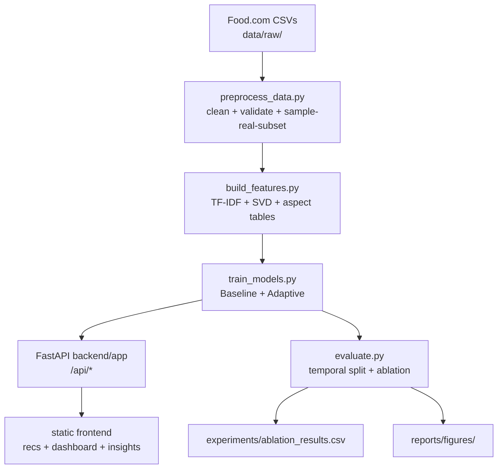

# Architecture

- `src/data/`: `schema.py` (discovery + validation), `loader.py`, `preprocess.py`, `features.py`
- `src/recommender/`: `baseline.py` (preserved hybrid), `temporal.py` (Addition #1),
  `aspect_model.py` (Addition #2), `hybrid.py` (`w1·base+w2·temp+w3·aspect`), `explanations.py`,
  `evaluate.py` (P@K/R@K/NDCG/HR + temporal split)
- Heavy artefacts cached: `models/*.joblib`, `data/processed/*`. API computes nothing expensive per request.
- **Virelle product layer** (engine untouched): `backend/app/db.py` (SQLite `tasteflow.db`:
  users, preferences, interactions, meal plans, shopping), `auth.py` (bcrypt + JWT),
  `api/{auth,profile,interactions,taste,search,mealplan,shopping,research,cards}.py`,
  `src/recommender/taste.py` (bridge: app activity → effective engine id + ephemeral
  per-user engine view sharing all precomputed artifacts). Historical Food.com rows and
  genuine app rows are kept distinct (`source` tag; app ids namespaced at 50M+ unless the
  account links to a Food.com demo history). Multi-page static frontend in `frontend/`.
